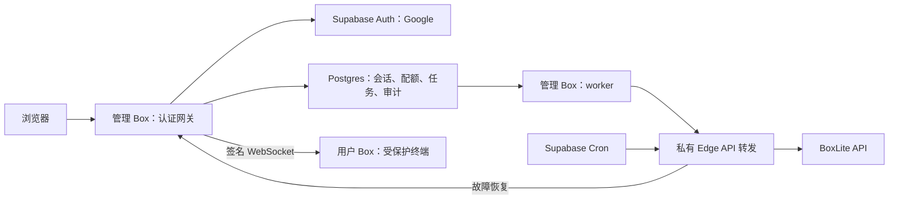

## TL;DR
Supabase 模式通过 Google 登录、专属网关和持久化任务管理用户的云端终端。

## Details

部署设计：[跟踪 issue](https://github.com/zombee0/web-terminal/issues/1)。



| 范围 | 行为 |
|---|---|
| 自部署 | 保留 Local 默认页、资源选择和直接 OPEN / COPY |
| Supabase | Cloud 默认、Local 置灰；保留 OPEN / COPY / STOP / RESUME / DELETE，OPEN 和 COPY 使用需要认证的访问链接 |
| 用户 Box | 每用户所有未删除 Box 合计最多 2 CPU / 4096 MiB；每 Box 磁盘最多 10 GB；创建、停止、错误状态仍占用配额 |
| 管理 Box | 4 CPU、8192 MiB、10 GB；只发布 3001；运行网关与 worker |
| 登录 | 服务端 Google PKCE；浏览器只持有 HttpOnly、Secure 会话 Cookie |
| 访问 | `/terminal/<应用 UUID>/`；HTTP、WebSocket、任务和 SSE 均检查归属 |
| Fleet | 只返回当前登录用户的 Box；管理员的个人 Fleet 也保持隔离 |
| 管理后台 | `/admin/`；仅查看全局 Box 用量和用户 Box 列表，支持搜索和分页；不能进入或操作其他用户的 Box |

### 部署

在 `~/.zshrc` 配置以下变量的字面值。部署器不会执行 shell 配置，也不会输出凭据。

```text
SUPABASE_URL
SUPABASE_PUBLISHABLE_KEY
SUPABASE_SECRET_KEY
SUPABASE_DB_URL
SUPABASE_ACCESS_TOKEN
BOXLITE_API_KEY
GOOGLE_OAUTH_CLIENT_ID
GOOGLE_OAUTH_CLIENT_SECRET
```

`SUPABASE_DB_URL` 使用含密码的 Session pooler 连接串。Google OAuth 的授权重定向 URI 应为 Supabase 项目的 `/auth/v1/callback`；部署器配置 Supabase 到应用的回调。

```bash
bash supabase/deploy.sh
```

重复部署复用已有管理 Box、数据库角色和加密密钥。入口保存在被 Git 忽略的 `.web-terminal/supabase/manager.json`；不要公开该文件。部署不需要推送 Git 分支。

管理 Box 无法直接访问 BoxLite API 时，后台经私有 Edge Function 转发 REST 请求。终端 WebSocket 直接由网关连接 tunnel 地址，不经过 Edge Function。转发凭据不接受用户 JWT，也不提供浏览器 CORS。

### 安全与恢复

- 上游 URL、provider ID、BoxLite key、Supabase token 不进入前端响应。网关只提供可信终端页面，不代理用户 Box 中的任意 HTML。
- 用户 Box 的 root PID 1 持有 3001 监听 socket，并重启终端服务。PTY 使用 UID/GID 1000、清理后的环境和 `no_new_privs`，无法读取配置或接管服务重启期间的端口。
- 网关每 10 秒复查会话与归属；退出、停止、删除会关闭连接。数据库不可用时拒绝访问。
- 数据库事务、配额触发器、幂等键、任务租约和 advisory lock 处理并发与重试。只有确认 provider 删除成功才释放配额。
- Cron 每分钟检查管理入口；停止或进程退出后恢复同一个管理 Box。令牌保存在 Supabase Vault。外部服务故障可能延长恢复时间。
- Auth 审计定期导入 `web_terminal.login_events`，应用登录与退出另有记录；创建及生命周期记录在 `boxes`、`jobs`、`lifecycle_events`。

运行时使用独立数据库角色，无 Auth 表读取权限；会话有效性和审计同步通过窄权限函数完成。私有 schema 不向 `anon` / `authenticated` 开放。

### 验证

```bash
make test-python
make test-go
make test-supabase-db
make test-supabase-live
make test-supabase-recovery
make test-supabase-admin-live
make test-supabase-ui
```

数据库测试使用临时 schema。真实环境测试会创建并清理测试身份和 Box；中断后复用 `.web-terminal/supabase/acceptance.json`，不要在清理完成前删除它。测试会话仅由部署端直接写入，不是应用登录接口；Google 授权仍需本人验证。

恢复测试会短暂停止管理 Box。测试通过后仅保留管理实例及真实用户资源。

### 运维

后台仅展示 Box 使用总览和列表，不提供终端入口、启停或删除操作，也不提供用户登录记录查询。普通用户不能进入后台；管理员访问其他用户的终端、WebSocket、任务或操作接口时仍被所有者校验拒绝。容量统计是 Box 配置总量，不是实时使用率。

管理员权限存入私有数据库表 `app_roles`，绑定 Supabase 用户 ID。普通管理员只读全站 Box 列表；站点所有者额外维护管理员和所有者名单。两者均不能访问或操作其他用户的 Box。

首次部署并完成一次 Google 登录后，使用数据库所有者连接初始化一个站点所有者：

```bash
.venv/bin/python -m supabase.bootstrap_owner --email owner@example.com
```

该命令只接受已登录过本站、Google 邮箱已验证的账号；已有所有者时不能通过初始化命令添加其他人。没有初始所有者时，后台默认不授权任何账号。升级不会自动导入旧 `admin_users` 或邮箱配置的授权。

之后在 `/admin/` 的 **ADMINISTRATORS** 中查找已登录用户的完整 Google 邮箱，核对账号后选择角色并应用。撤销权限选择 User。每个请求查询当前角色及 Google 验证状态，变更后下次请求生效，无需重新部署或登录。普通管理员不能管理名单。

角色变更与 `role_events` 审计记录在同一数据库事务内保存，记录操作者、目标、原角色、新角色和时间。受限运行身份不能直接写角色或修改审计记录；变更函数再次核验会话及所有者权限，串行保护最后一个可用所有者，并拒绝覆盖过期页面中的角色。后台支持分页查看授权记录。

`supabase/deployment.json`、`WEB_TERMINAL_DEPLOYMENT_CONFIG` 和旧服务器 `admin_emails` 字段不再参与授权，新部署不再复制管理员名单。所有者账号全部无法登录时，由项目数据库所有者人工核验身份后恢复，不自动授予首个注册者权限。

保管 `.web-terminal/supabase/secrets.json`：其中包含应用加密及签名密钥和受限数据库凭据。丢失加密密钥会使现有会话失效。不要将其放进仓库、用户 Box 或镜像。

管理配置位于 `/etc/web-terminal/manager.json`，仅 root 可读；日志仅输出固定状态或异常类型。应用代码位于 `/opt/web-terminal/current`。完整证书校验使用随仓库提供的 Supabase 官方 CA。

本架构使用一个管理实例，恢复依赖 Supabase 与 BoxLite 的可用性。上线规模增大后，可拆分网关和 worker，并评估数据库连接、任务并发及服务配额。
